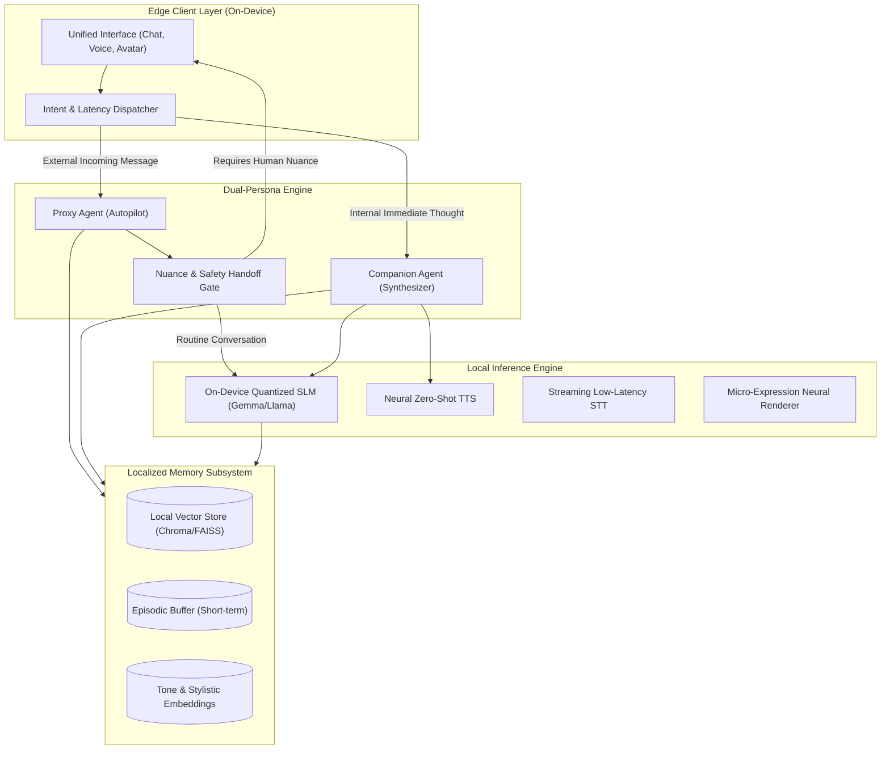

# Project Echo: Technical Architecture Specification

## Overview

Project Echo is an edge-native, local-first artificial companion framework. It decouples human availability from human connection through two cooperating agents: **The Proxy** and **The Companion**.

---

## 1. High-Level System Architecture

---

## 2. Core Subsystems

### 2.1 The Latency Budget (<200ms)
To solve the "emotional ticking clock", the Companion agent must operate within a human-reflex conversational window:
- **Streaming STT**: Target <70ms First-Chunk-To-Text.
- **Speculative LLM Decoding**: Local quantizations (4-bit/8-bit GGUF/AWQ) on consumer NPU/GPU executing first token in <90ms.
- **Streaming Audio Synthesis**: Chunked neural vocoding yielding audible response within <180ms total glass-to-glass latency.

### 2.2 The Proxy (Autopilot) & The Handoff Gate
The Proxy operates under strict supervisory criteria:
1. **Confidence Thresholding**: Every generated autopilot response is assigned a nuance score \(S_n \in [0, 1]\).
2. **Sentiment & Crisis Triggers**: If incoming messages indicate grief, contractual commitment, financial exchange, or deep emotional vulnerability, the handoff gate interrupts autopilot and queues an urgent push notification to the human operator.
3. **Tone Mirroring**: Continuously fine-tuned on historical chat logs using Low-Rank Adaptation (LoRA) or few-shot context injection from the localized stylistic embedding store.

### 2.3 The Companion (Synthesizer) & Peer Simulation
The Companion serves as an instantaneous creative and emotional sounding board:
- **Dynamic Peer Profiles**: Allows the user to select conversational personas (e.g. *The Analytical Critic*, *The Empathetic Confidant*, *The Brainstorming Partner*).
- **Consequence-Free Isolation**: Sessions operate in an ephemeral sandbox unless explicitly committed to long-term memory by the user.

---

## 3. Privacy-First Boundary
All model weights, contextual memory vectors, and audio samples remain strictly on the host hardware. Zero telemetry is broadcast to public cloud servers without explicit user-signed cryptographic export.
